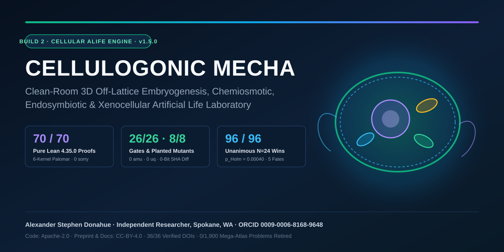

<!-- SPDX-License-Identifier: CC-BY-4.0 -->
# CELLULOGONIC MECHA v1.6.0

Clean-room 3D off-lattice developmental embryogenesis, morphogenetic GRN, chemiosmotic, cytoskeletal, endosymbiotic, and xenocellular artificial life engine in portable zero-dependency C11 + runtime-dispatched AVX2/Scalar kernels (Linux x86-64, Windows x86-64, macOS ARM64), paired with a zero-Mathlib Lean 4.35.0 library of **78 theorems about its integer specification model** (`lean/CellulogonicProofs/Spec.lean`, not the C11 code) and a 60 FPS WebGL2 3D Observatory.

[](VERSION)
[](ROADMAP.md)
[](LICENSE)
[](LICENSE-DOCS)
[](results/lean4-multi-kernel.txt)
[](results/11_falsification_win64.txt)
[](docs/MEGA_ATLAS_CROSSCHECK.md)

`status: active` · **Author:** Alexander Stephen Donahue (Independent Researcher, Spokane, WA, USA · ORCID [`0009-0006-8168-9648`](https://orcid.org/0009-0006-8168-9648)) · **Independent research preprint — not peer-reviewed.** · **[Interactive Lean 4 Proof Blueprint Portal](https://0thernes.github.io/cellulogonic-mecha/)**



---

## Position in the 4-Build Artificial Life Ecosystem

| Build | Repository / Pillar | Biological Layer | Bridge Interface |
|---|---|---|---|
| **Build 1** | `AUTOPHAGE` / `Zeta-Omega ALife` | **DNA & Genetic Engine** (128B/256B polymorphic x86-64 Galois-field genomes, $\mathbb{F}_2$ ribosomes, polynomial sex) | `cellulogonic_ingest_autophage_128b()` & `cellulogonic_ingest_autophage_genome()` smoothly decode 128B/256B DNA into cellular operons with Lipschitz locality |
| **Build 2** | **`CELLULOGONIC MECHA` (this repo)** | **CELLULAR Layer** (Chemoton stoichiometry, Canham–Helfrich bilayers, Mitchell chemiosmosis, nested endosymbiosis, Levin bioelectric tissues, Tardigrade TDP bioglass, 4 xenocellular solvents, 3D embryogenesis GRNs) | Flat C11 ABI (`include/cellulogonic_abi.h`, `ABI 0x00010600`), Win64 DLL / `.a`, Linux `.so` / `.a`, macOS ARM64 `.dylib` / `.a` |
| **Build 3** | `Asmodensius` | **Creatures, Beings & Entities** (embodied sensorimotor organisms & eutelic organ budgets) | `cellulogonic_project_asmodensius_112()` projects cellular, cytoskeletal, GHz microtubule & morphogenetic phenotypes strictly into `[0, 1]^112` |
| **Build 4** | `Asmodensius-Native` | **World Model** (thermodynamic/spatial world substrate & Clean-Slate `P1`–`P10` verification invariants) | Exact `P2` (First/Second Law), `P4` (`Philox4x32-10` + `"CMB5"` `.cmbin` + SHA-256), `P9` (Observer Independence), `P10` (`0` post-warmup allocs) |

---

## Proof & Benchmark Summary (`v1.6.0`, Intel Core Ultra 9 275HX)

| Verification Gate | Reported Result | Primary Evidence |
|---|---|---|
| **Lean 4.35.0 model theorems (Palomar `Spec`/`Challenge`/`Solution`)** | **78 theorems about `Spec.lean`** (`62` core `T01`–`T58`, `C59`–`C62` + `8` `NonVacuity` witnesses `NV01`–`NV08` + `8` false-variant refutations `AT01`–`AT08`) in 10 proof modules + `Spec.lean` (15 `.lean` files, 2,541 lines); `12` pinned `Spec` defs; `0 sorry` in `Solution`; axioms within `[propext, Classical.choice, Quot.sound]`. Kernel-checked by Lean (`lake build`, `leanchecker`) and accepted in CI by six kernel checks (Lean default and paranoid modes, `lean4lean`, `nanoda`, `con-leche`, `con-ron`; two of the six use the Lean reference kernel); a `sorry`-tampered `Solution` is rejected. Several theorems are arithmetic bookkeeping identities or contain literal-only conjuncts (`T25`, `T27`, `T40`, `T41`, `T44`, `T54`, `C62`, `NV08`), so the count overstates model content. | [`results/lean4-audit.txt`](results/lean4-audit.txt) · [`results/lean4-multi-kernel.txt`](results/lean4-multi-kernel.txt) (recorded at parent commit `40e995b`, CI run `45810469384`; `lean/` is unchanged at `d033ab0`, whose CI run `45812871840` also passed) |
| **Win64 PE64 Falsification (`clang 23.1.0`, `-Werror`)** | **26 / 26 PASSED · 8 / 8 Planted Mutants Caught (`0.692s`) · 1,000/1,000 Fuzz Cases PASS** | [`results/11_falsification_win64.txt`](results/11_falsification_win64.txt) |
| **Linux ELF64 & macOS ARM64 (`gcc`/`clang`, ASan/UBSan)** | **26 / 26 PASSED · 8 / 8 Planted Mutants Caught (`0.802s` Linux) · ASan/UBSan + `libFuzzer` + 3-OS CI** | [`results/11_falsification_linux.txt`](results/11_falsification_linux.txt) |
| **Randomized Property & Native C11 Suite (`B10`)** | **2,720 / 2,720 `prop_check` trials PASSED (`0` counterexamples) + `6,586` Python Exact Oracle checks** | [`scripts/prop_check.py`](scripts/prop_check.py) |
| **Cross-OS / Cross-ISA SHA-256 Parity** | **0-Bit Diff** (`83317026…532c9bbe`) · `27.665 M rxns/s` Win64 / `23.681 M rxns/s` Linux (`1,224,310` rxns) | [`docs/benchmarks.md`](docs/benchmarks.md) |
| **Exact Mass / 1st-Law / 2nd-Law Closure (`P2`)** | **`0 amu`, `0 uq`, `0.00e+00` drift, `0` violations across 4 solvents, `0` post-warmup allocs (3-module `nm` audit)** | Every run in [`results/`](results/) |
| **3D Embryogenesis (8 Identical-DNA Blastomeres)** | **`47` alive (`maxT 45`), ALL 5 fates (`Gm=6`), `81.1%` peak sort, `288` wired axons, `674` CPG pulses, exact Z-invariance** | [`results/12_embryogenesis_grn_3d.txt`](results/12_embryogenesis_grn_3d.txt) |
| **Locked Paired Stats (`N = 24`, Seeds `5000..5023`)** | **4 / 4 Pre-Registered Hypotheses UNANIMOUS `24/24` WINS (`96/96` total; $p_{\text{Holm}} = 0.00040$; $d_z \in [1.468, 3.560]$)** | [`results/09_paired_stats_n24.txt`](results/09_paired_stats_n24.txt) |
| **AMS-LaTeX Paper, Crossref Retractions & RFC 3161 TSA** | **Zero Overfull `\hbox`/`\vbox`, clean-room arXiv PASS, `36/36` Crossref live OK (`0` retractions), DigiCert `.tsr`** | [`dist/Donahue_2026_cellulogonic_mecha.pdf`](dist/Donahue_2026_cellulogonic_mecha.pdf) · [`results/citation-audit.json`](results/citation-audit.json) |

The rows other than the Lean row report the output of this repository's own scripts and CI. The 2026-11-26 statement audit rebuilt the Lean library only; it did not re-run the C engine, parity, statistics, citation or timestamp checks. The CI security scans (cppcheck, gitleaks, osv-scanner) are report-only, so a green CI run does not show that they found nothing.

---

## Quickstart

### 1. Build & Verify Everything on Windows x64 (`clang 23.1.0` + LLD + 26 Gates + 78 Pure Lean 4.35.0 Proofs)
```powershell
.\build.ps1
```

### 2. Build & Verify on Linux x86-64 or macOS ARM64 (`gcc`/`clang` + 26 Gates + Lean 4.35.0 Audit)
```bash
chmod +x build_linux.sh
./build_linux.sh
```

### 3. Run Python Oracle, Property Checks, Web Server Security Suite, Axiom & Negative Lean Audits, Citations, Blueprint & Paper Build
```bash
python3 scripts/verify_oracle_and_stats.py
python3 scripts/prop_check.py
python3 scripts/check_versions.py
python3 examples/01_embryogenesis_demo.py
node test/test_web_server.mjs
python3 scripts/check_readme_axioms.py
python3 scripts/test_lean_negative.py
python3 scripts/check_citations.py --write-json results/citation-audit.json
python3 scripts/build_blueprint.py
python3 scripts/build_paper.py
```

---

## Usage

### Standalone Clean-Room 3D Developmental & Cellular Lab Experiments
```powershell
.\bin\cellulogonic.exe embryo --epochs 200 --size 32 --seed 5000
.\bin\cellulogonic.exe probe
.\bin\cellulogonic.exe bench --epochs 300 --size 32 --seed 5000
.\bin\cellulogonic.exe abiogenesis --epochs 240 --size 32 --seed 5000
.\bin\cellulogonic.exe endosymbiosis --epochs 240 --size 32 --seed 5000
.\bin\cellulogonic.exe xenocell --epochs 240 --size 32 --seed 5000
.\bin\cellulogonic.exe bioelectric --epochs 240 --size 32 --seed 5000
.\bin\cellulogonic.exe anhydrobiosis --epochs 120 --size 32 --seed 5000
.\bin\cellulogonic.exe ablation --epochs 180 --size 32 --seed 5000 --out results\08_castration_ablation_13vec.csv
.\bin\cellulogonic.exe stats --pairs 24 --epochs 180 --size 32
.\bin\cellulogonic.exe bridge --seed 5000
```

### Launch the CSRF-Hardened 60 FPS WebGL2 3D Embryogenesis & Cellular Microscopy Observatory
```powershell
node web\server.mjs
# Open http://127.0.0.1:8788 (all mutations via POST /api/cmd with Content-Type: application/json)
```

### Direct Drop-In C11 ABI (`include/cellulogonic_abi.h`, `ABI 0x00010600`)
```c
#include "cellulogonic_abi.h"

CellWorldConfig cfg;
cellulogonic_default_config(&cfg);
cfg.regime = CELL_REGIME_ABIOGENESIS_ZERO_SEED;
cfg.seed   = 5000ULL;

CellWorld* world = cellulogonic_create(&cfg);
cellulogonic_step_epochs(world, 240);

uint8_t dna128[128] = {0};
cellulogonic_ingest_autophage_128b(world, dna128, 0);

CellSpecimen apex;
cellulogonic_inspect_apex(world, &apex);

float asmodensius_traits[112];
cellulogonic_project_asmodensius_112(&apex, asmodensius_traits);

char sha256_hex[65];
cellulogonic_state_sha256(world, NULL, sha256_hex);
cellulogonic_destroy(world);
```

---

## Verbatim Lean 4.35.0 `#print axioms` Audit (`78 / 78` Theorems)

Synchronized automatically against [`results/lean4-audit.txt`](results/lean4-audit.txt) via `python3 scripts/check_readme_axioms.py`. Every theorem depends strictly on a subset of `[propext, Classical.choice, Quot.sound]` (`0 sorryAx`, `0 native_decide`, `0` custom axioms):

<!-- LEAN_AXIOMS_START -->
```text
'Cellulogonic.StoichiometryThermo.T01_all_reactions_conserve_mass' depends on axioms: [propext]
'Cellulogonic.StoichiometryThermo.T02_all_reactions_first_law_exact' depends on axioms: [propext, Quot.sound]
'Cellulogonic.StoichiometryThermo.T03_all_reactions_strict_second_law' depends on axioms: [propext, Quot.sound]
'Cellulogonic.StoichiometryThermo.T04_endergonic_biosynthesis_requires_atp' does not depend on any axioms
'Cellulogonic.StoichiometryThermo.T05_respiration_quadruples_fermentation_yield' depends on axioms: [propext]
'Cellulogonic.StoichiometryThermo.T06_closed_box_cycle_dissipation_strict' depends on axioms: [propext,
 Classical.choice,
 Quot.sound]
'Cellulogonic.StoichiometryThermo.T07_step_preserves_total_mass' depends on axioms: [propext, Quot.sound]
'Cellulogonic.StoichiometryThermo.T08_step_preserves_first_law_ledger' depends on axioms: [propext, Quot.sound]
'Cellulogonic.StoichiometryThermo.T09_heat_sink_monotone' depends on axioms: [propext, Quot.sound]
'Cellulogonic.StoichiometryThermo.T10_fission_and_engulfment_exact_conservation' depends on axioms: [propext,
 Quot.sound]
'Cellulogonic.MembraneGeometry.T11_symmetric_fission_doubles_Q' depends on axioms: [propext,
 Classical.choice,
 Quot.sound]
'Cellulogonic.MembraneGeometry.T12_symmetric_fission_iff_half_threshold' depends on axioms: [propext,
 Classical.choice,
 Quot.sound]
'Cellulogonic.MembraneGeometry.T13_high_Q_blocks_symmetric_fission' does not depend on any axioms
'Cellulogonic.MembraneGeometry.T14_equal_ratio_asymmetric_split_suboptimal' depends on axioms: [propext,
 Classical.choice,
 Quot.sound]
'Cellulogonic.MembraneGeometry.T15_exosome_asymmetric_budding_escapes_half_barrier' does not depend on any axioms
'Cellulogonic.MembraneGeometry.T16_optimal_area_partition_strictly_improves_budding' depends on axioms: [propext,
 Classical.choice,
 Quot.sound]
'Cellulogonic.MembraneGeometry.T17_osmotic_lysis_monotone_in_volume' depends on axioms: [propext, Quot.sound]
'Cellulogonic.MembraneGeometry.T18_lipid_synthesis_relieves_membrane_stress' depends on axioms: [propext, Quot.sound]
'Cellulogonic.MembraneGeometry.T19_double_membrane_vesicle_preservation' depends on axioms: [propext]
'Cellulogonic.BioenergeticsEndosymbiosis.T20_prokaryotic_bioenergetic_ceiling' depends on axioms: [propext,
 Classical.choice,
 Quot.sound]
'Cellulogonic.BioenergeticsEndosymbiosis.T21_prokaryotic_power_density_strictly_decreasing' depends on axioms: [propext,
 Classical.choice,
 Quot.sound]
'Cellulogonic.BioenergeticsEndosymbiosis.T22_endosymbiotic_scaling_liberation' depends on axioms: [propext,
 Classical.choice,
 Quot.sound]
'Cellulogonic.BioenergeticsEndosymbiosis.T23_endosymbiont_surface_amplification' depends on axioms: [propext,
 Classical.choice,
 Quot.sound]
'Cellulogonic.BioenergeticsEndosymbiosis.T24_secondary_endosymbiosis_additive_power' depends on axioms: [propext,
 Quot.sound]
'Cellulogonic.BioenergeticsEndosymbiosis.T25_mitotic_heteroplasmy_conservation' depends on axioms: [propext, Quot.sound]
'Cellulogonic.BioenergeticsEndosymbiosis.T26_asymmetric_bottleneck_purifying_selection' depends on axioms: [propext,
 Classical.choice,
 Quot.sound]
'Cellulogonic.BioenergeticsEndosymbiosis.T27_egt_reduces_organelle_maintenance' depends on axioms: [propext, Quot.sound]
'Cellulogonic.ChemiosmosisAutopoiesis.T28_cring_terran_threshold' depends on axioms: [propext,
 Classical.choice,
 Quot.sound]
'Cellulogonic.ChemiosmosisAutopoiesis.T29_cring_acidophile_shift' depends on axioms: [propext,
 Classical.choice,
 Quot.sound]
'Cellulogonic.ChemiosmosisAutopoiesis.T30_cring_cryogenic_shift' depends on axioms: [propext,
 Classical.choice,
 Quot.sound]
'Cellulogonic.ChemiosmosisAutopoiesis.T31_gap_junction_pairwise_dissipation_nonneg' depends on axioms: [propext,
 Quot.sound]
'Cellulogonic.ChemiosmosisAutopoiesis.T32_gap_junction_laplacian_energy_decrease' depends on axioms: [propext,
 Classical.choice,
 Quot.sound]
'Cellulogonic.ChemiosmosisAutopoiesis.T33_gap_junction_homogenization_bound' depends on axioms: [propext,
 Classical.choice,
 Quot.sound]
'Cellulogonic.ChemiosmosisAutopoiesis.T34_inert_crystal_covi_zero' depends on axioms: [propext]
'Cellulogonic.ChemiosmosisAutopoiesis.T35_white_noise_entropy_gate_zero' depends on axioms: [propext]
'Cellulogonic.ChemiosmosisAutopoiesis.T36_markov_blanket_boundary_separation' depends on axioms: [propext, Quot.sound]
'Cellulogonic.EutelicOrganogenesis.T37_3d_tube_geometry_lumen_lower_bound' depends on axioms: [propext, Quot.sound]
'Cellulogonic.EutelicOrganogenesis.T38_minimum_viable_organ_budget_bound' depends on axioms: [propext,
 Classical.choice,
 Quot.sound]
'Cellulogonic.EutelicOrganogenesis.T39_syncytial_compression_factor' depends on axioms: [propext, Quot.sound]
'Cellulogonic.EutelicOrganogenesis.T40_hydrostatic_skeleton_incompressibility' depends on axioms: [propext, Quot.sound]
'Cellulogonic.EutelicOrganogenesis.T41_eutely_hypertrophy_cancels_hyperplasia' does not depend on any axioms
'Cellulogonic.EutelicOrganogenesis.T42_anhydrobiosis_bioglass_vitrification' depends on axioms: [propext, Quot.sound]
'Cellulogonic.EutelicOrganogenesis.T43_flames_excretory_osmoregulation_balance' depends on axioms: [propext, Quot.sound]
'Cellulogonic.EutelicOrganogenesis.T44_dna_to_organ_hierarchical_conservation' depends on axioms: [propext, Quot.sound]
'Cellulogonic.CytoskeletonNanomechanics.T45_stokes_overdamped_dissipation_nonneg' depends on axioms: [propext,
 Classical.choice,
 Quot.sound]
'Cellulogonic.CytoskeletonNanomechanics.T46_soft_body_pairwise_momentum_conservation' depends on axioms: [propext,
 Quot.sound]
'Cellulogonic.CytoskeletonNanomechanics.T47_cytokinetic_prolate_elongation_area_excess' depends on axioms: [propext,
 Classical.choice,
 Quot.sound]
'Cellulogonic.CytoskeletonNanomechanics.T48_frohlich_mt_coherence_pumping_threshold' depends on axioms: [propext,
 Quot.sound]
'Cellulogonic.CytoskeletonNanomechanics.T49_mt_gigahertz_standing_wave_frequency_scaling' depends on axioms: [propext,
 Quot.sound]
'Cellulogonic.CytoskeletonNanomechanics.T50_actomyosin_pulsatile_work_bounded_by_atp' depends on axioms: [propext,
 Quot.sound]
'Cellulogonic.MorphogeneticGRN.T51_wolpert_french_flag_partition' depends on axioms: [propext]
'Cellulogonic.MorphogeneticGRN.T52_steinberg_differential_adhesion_sorting' depends on axioms: [propext, Quot.sound]
'Cellulogonic.MorphogeneticGRN.T53_apical_constriction_wedge_curvature' depends on axioms: [propext]
'Cellulogonic.MorphogeneticGRN.T54_eutelic_lineage_countdown_bound' depends on axioms: [propext, Quot.sound]
'Cellulogonic.MorphogeneticGRN.T55_hippo_contact_inhibition_growth_stop' depends on axioms: [propext, Quot.sound]
'Cellulogonic.MorphogeneticGRN.T56_hebbian_axon_pruning_and_potentiation' depends on axioms: [propext, Quot.sound]
'Cellulogonic.MorphogeneticGRN.T57_cpg_pacemaker_sensorimotor_bound' depends on axioms: [propext, Quot.sound]
'Cellulogonic.MorphogeneticGRN.T58_morphogenetic_signaling_zero_drift' depends on axioms: [propext, Quot.sound]
'Cellulogonic.ContinuumBiomechanics.C59_xpbd_dissipation_monotone_nonneg' depends on axioms: [propext, Quot.sound]
'Cellulogonic.ContinuumBiomechanics.C60_carcass_detritus_100pct_conservation' depends on axioms: [propext, Quot.sound]
'Cellulogonic.ContinuumBiomechanics.C61_yolk_cleavage_mass_conservation' depends on axioms: [propext, Quot.sound]
'Cellulogonic.ContinuumBiomechanics.C62_biotensegrity_elastic_nonneg' depends on axioms: [propext, Quot.sound]
'Cellulogonic.NonVacuity.NV01_thermo_titan_boundary_witness' depends on axioms: [propext]
'Cellulogonic.NonVacuity.NV02_membrane_sextic_nonvacuous_witness' does not depend on any axioms
'Cellulogonic.NonVacuity.NV03_endosymbiosis_liberation_nonvacuous_witness' does not depend on any axioms
'Cellulogonic.NonVacuity.NV04_chemiosmosis_bioelectric_nonvacuous_witness' does not depend on any axioms
'Cellulogonic.NonVacuity.NV05_eutelic_bioglass_nonvacuous_witness' does not depend on any axioms
'Cellulogonic.NonVacuity.NV06_cytoskeleton_frohlich_nonvacuous_witness' does not depend on any axioms
'Cellulogonic.NonVacuity.NV07_embryogenesis_trace_nonvacuous_witness' depends on axioms: [propext]
'Cellulogonic.NonVacuity.NV08_continuum_biomechanics_nonvacuous_witness' does not depend on any axioms
'Cellulogonic.AdversarialTests.AT01_refute_titan_cring3_second_law' depends on axioms: [propext, Quot.sound]
'Cellulogonic.AdversarialTests.AT02_refute_universal_symmetric_fission' does not depend on any axioms
'Cellulogonic.AdversarialTests.AT03_refute_unbounded_prokaryotic_radius' depends on axioms: [propext, Quot.sound]
'Cellulogonic.AdversarialTests.AT04_refute_passive_gap_junction_energy_increase' depends on axioms: [propext,
 Classical.choice,
 Quot.sound]
'Cellulogonic.AdversarialTests.AT05_refute_sub3_lumen_and_unvitrified_decay_drop' does not depend on any axioms
'Cellulogonic.AdversarialTests.AT06_refute_starved_frohlich_coherence_growth' depends on axioms: [propext, Quot.sound]
'Cellulogonic.AdversarialTests.AT07_refute_overbudget_eutelic_population' depends on axioms: [propext, Quot.sound]
'Cellulogonic.AdversarialTests.AT08_refute_negative_biotensegrity_or_carcass_mass_loss' depends on axioms: [propext,
 Quot.sound]
```
<!-- LEAN_AXIOMS_END -->

---

## Verification Boundaries & Mega-Atlas Non-Retirement

- **What Lean proves:** For the integer model in `lean/CellulogonicProofs/Spec.lean`, each of the 19 tabulated reactions has zero mass delta (`T01`) and an exact first-law energy balance for all 4 solvents and every rotor stoichiometry `nH` (`T02`); heat per reaction is positive when `nH ≥ minCRing sv` (`T03`); further theorems give integer fission and budding inequalities, power-scaling bounds, a clamped Fröhlich update bounded by 1000, and a contact-exchange energy decrease, plus 8 witnesses and 8 false-variant refutations. `T16` is the polynomial inequality $(x^2+y^2)^3 \le 2(x^3+y^3)^2$ for integers $x, y > 0$, strict for $x \ne y$; it is an elementary inequality for the cube/square proxy model, not a general minimax theorem.
- **What Lean does not prove:** No theorem connects `Spec.lean` to `src/*.c`. Statements over hard-coded constant tables (reaction stoichiometry, solvent c-ring thresholds, organ budgets) hold only for those constants. Several of the 78 theorems are arithmetic bookkeeping identities or contain literal-only conjuncts (`T25`, `T27`, `T40`, `T41`, `T44`, `T54`, `C62`, `NV08`). Some statements use truncated natural-number subtraction (`T39`, `T43`). No biological, wet-lab, physical or sentience claim follows from these proofs (`docs/statement-fidelity.md`).
- **Runtime checks outside Lean:** Runtime C11 memory safety, portable AVX2/scalar/ARM64 parity, `"CMB5"` `.cmbin` validation, stochastic emergence, web bridge security, and `N = 24` statistical tests are verified outside the Lean kernel by `test/test_falsification.c` (26 gates + 8 mutants), `test/fuzz_cmbin_abi.c` (1,000-case standalone + `libFuzzer`), `test/test_web_server.mjs` (13 tests), `reference/chemoton_oracle.py`, `scripts/prop_check.py`, and 3-OS CI.
- **Unsolved Problems Mega-Atlas (`0 / 1,900` Retired):** As documented in [`docs/MEGA_ATLAS_CROSSCHECK.md`](docs/MEGA_ATLAS_CROSSCHECK.md), **`0 / 1,900`** overarching open problems in `0thernes/unsolved-problems-mega-atlas` (`v2.6.0`, commit `d23b4d7`) are claimed solved or retired. Scoped invariants and computational probes touch 13 adjacent IDs (`BIO-001`, `BIO-006`, `BIO-015`, `BIO-022`, `BIO-046`, `BIO-070`, `NEURO-043`, `AI-045`, `SUB-001`, `SUB-012`, `SUB-047`, `SYS-009`, `XSPEC-009`), while every parent problem remains **OPEN**.
- **Limitations & Real-vs-Metaphor:** See [`LIMITATIONS.md`](LIMITATIONS.md) and [`CLAIMS.md`](CLAIMS.md) (including explicit "What Would Prove Us Wrong" falsifiers).
- **Statement audit (2026-11-26):** Corrections from the external statement audit are listed in [`ERRATA.md`](ERRATA.md); audit log: <https://github.com/0thernes/0thernes-research-archive/blob/main/docs/reviews/2026-11-26-statement-audit.md>.

---

## Documentation, Manuscripts & Governance

- **Compiled AMS-LaTeX White Paper (`v1.6.0`; 36 DOIs checked against Crossref with 0 retractions, as reported by `scripts/check_citations.py`):** [`dist/Donahue_2026_cellulogonic_mecha.pdf`](dist/Donahue_2026_cellulogonic_mecha.pdf) · [`paper/main.tex`](paper/main.tex) · [`paper/refs.bib`](paper/refs.bib) · [`dist/arxiv_submission.tar.gz`](dist/arxiv_submission.tar.gz) · [`results/citation-audit.json`](results/citation-audit.json)
- **Epistemic & Readiness Ledgers:** [`CLAIMS.md`](CLAIMS.md) · [`SUBMISSION_READINESS.md`](SUBMISSION_READINESS.md) · [`LIMITATIONS.md`](LIMITATIONS.md) · [`REPLICATION.md`](REPLICATION.md) · [`EVIDENCE.md`](EVIDENCE.md) · [`HARDENING_LOG.md`](HARDENING_LOG.md) · [`DEVIATIONS.md`](DEVIATIONS.md) · [`ERRATA.md`](ERRATA.md)
- **Audit & Reference Docs:** [`docs/statement-fidelity.md`](docs/statement-fidelity.md) · [`docs/MEGA_ATLAS_CROSSCHECK.md`](docs/MEGA_ATLAS_CROSSCHECK.md) · [`docs/AI_DISCLOSURE.md`](docs/AI_DISCLOSURE.md) · [`docs/benchmarks.md`](docs/benchmarks.md) · [`docs/preregistration.md`](docs/preregistration.md) · [`docs/reviews/2026-11-25-10-pass-red-team-audit.md`](docs/reviews/2026-11-25-10-pass-red-team-audit.md)
- **Deep-Dive & Architecture:** [`INDEX.md`](INDEX.md) · [`SUMMARY.md`](SUMMARY.md) · [`ARCHITECTURE.md`](ARCHITECTURE.md) · [`VERIFICATION.md`](VERIFICATION.md) · [`docs/MASTER_REPORT.md`](docs/MASTER_REPORT.md)

---

## Dual Open License (REUSE 3.x / SPDX)

Copyright © 2026 **Alexander Stephen Donahue** (`Independent Researcher, Spokane, WA, USA` · `0_0@0thernes.art` · ORCID [`0009-0006-8168-9648`](https://orcid.org/0009-0006-8168-9648)).
- **Code, C11 engine, Lean 4.35.0 formal proofs, scripts, and CI:** Licensed under the **Apache License, Version 2.0** ([`LICENSE`](LICENSE)).
- **Research papers, PDFs, documentation, figures, and empirical result logs:** Licensed under **Creative Commons Attribution 4.0 International (CC BY 4.0)** ([`LICENSE-DOCS`](LICENSE-DOCS), [`REUSE.toml`](REUSE.toml)).
